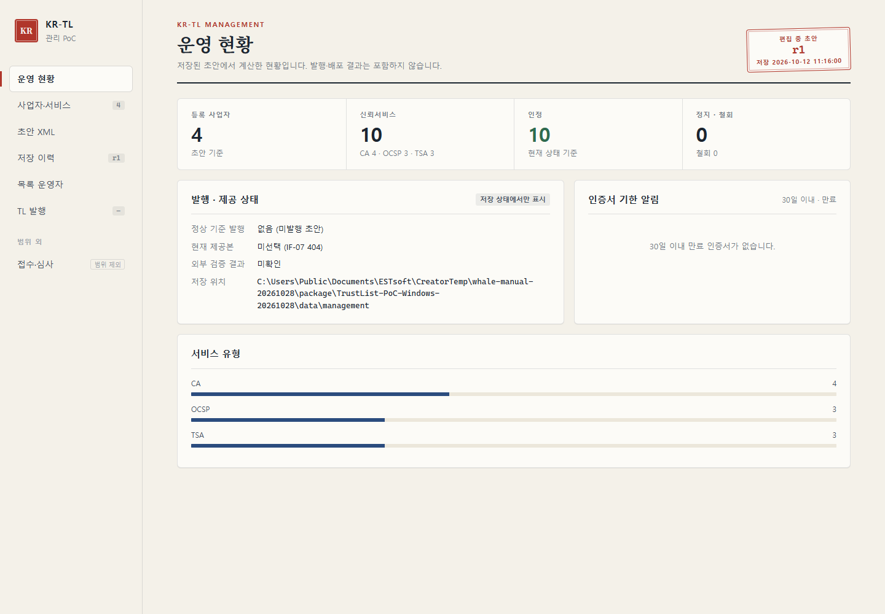
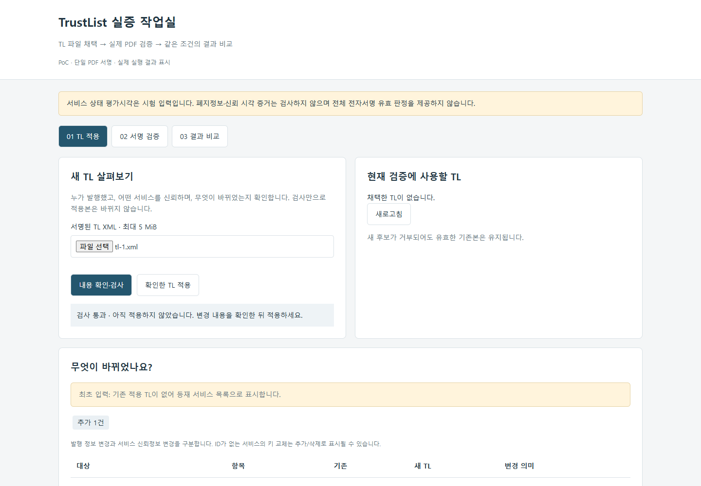
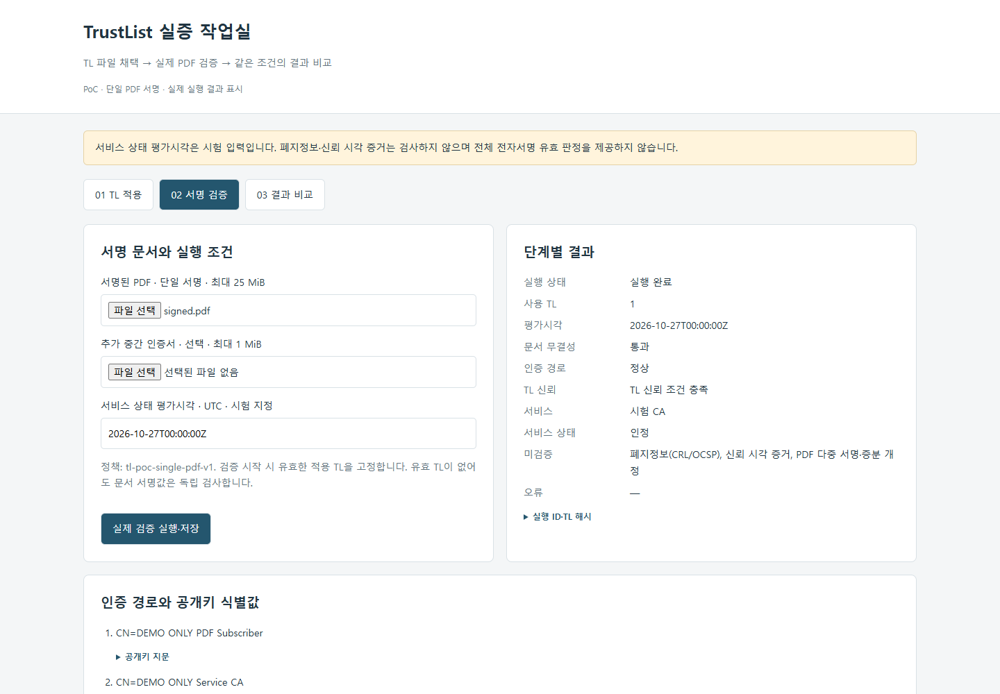
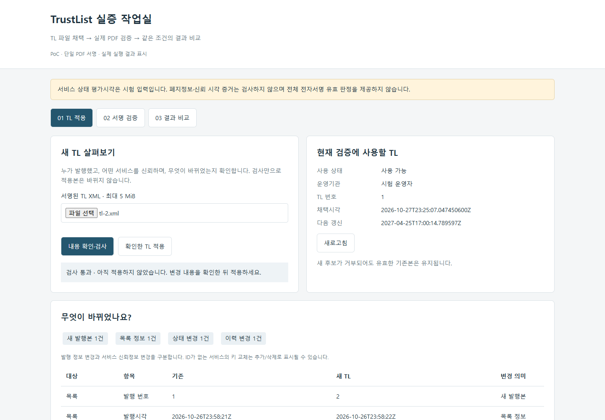
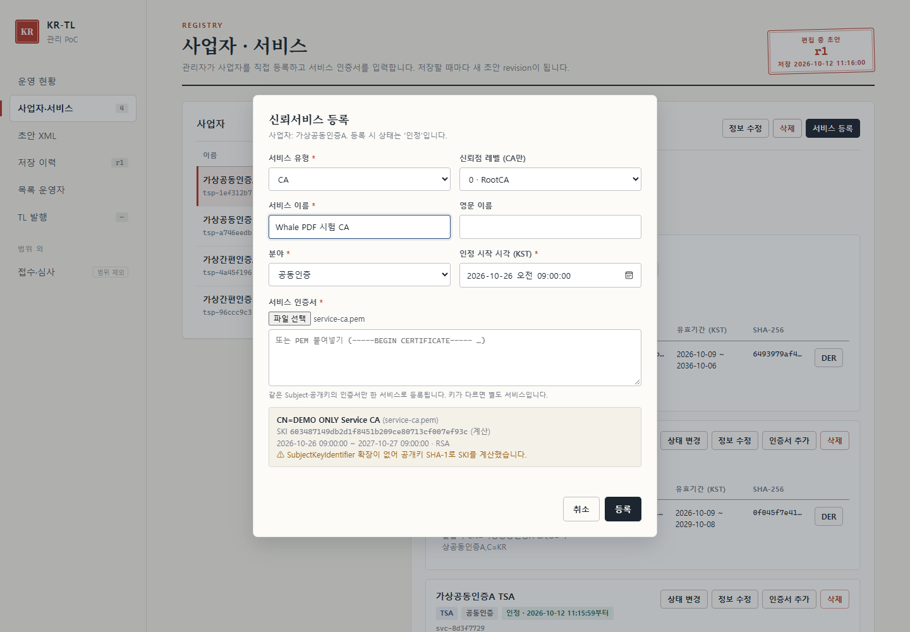
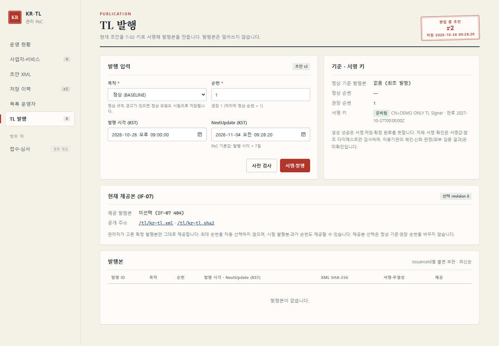
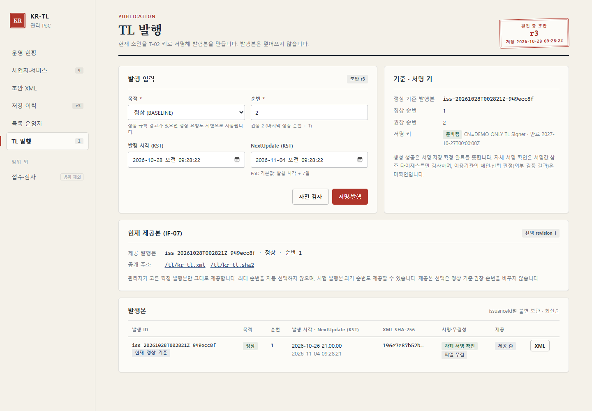
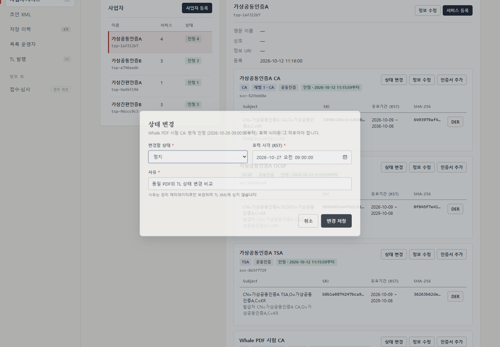
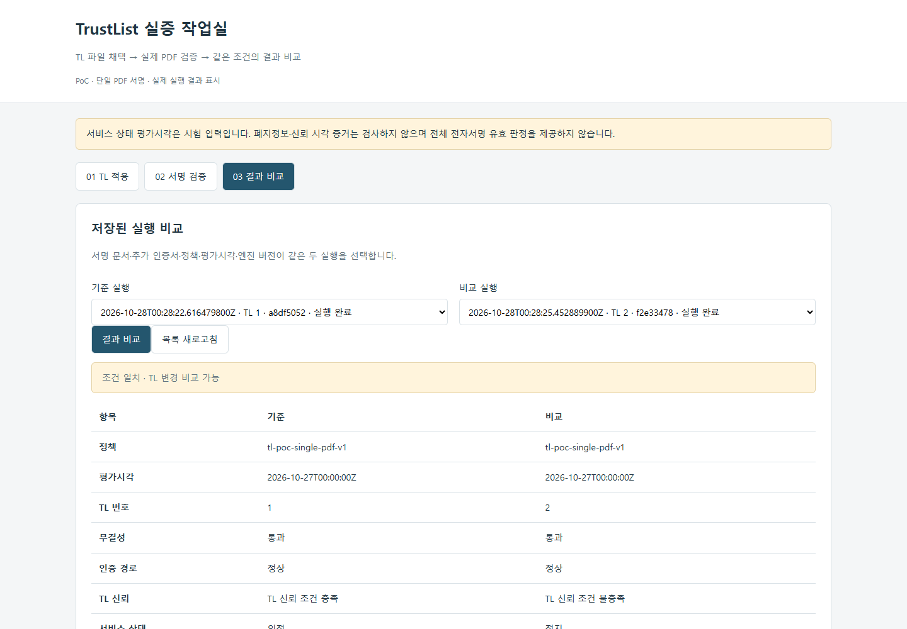

# TrustList 관리 시스템 TL 작업대 사용 매뉴얼

네이버 웨일 개발자용

샘플 TL 비교 · 직접 발행 · API 수신 시험

v1.0 · 2026.10.28

## 목차

| 구성 | 내용 |
| --- | --- |
| 1. 실행 환경 | Java 설정, 시작·종료, 접속 주소 |
| 2. 화면 구성 | 관리 시스템과 TL 작업대 |
| 3. 샘플 TL 비교 | TL 1 → PDF 검증 → TL 2 → 같은 조건으로 비교 |
| 4. 관리 TL 발행 | CA 등록 → 발행·제공 → 다운로드 → 상태 변경·재검증 |
| 5. 문제 해결 | 실행 오류와 TL 등록 오류 |

## 실행 환경

배포 폴더에서 Start-Poc.cmd를 실행합니다. 접속 포트는 config.json에서 변경합니다.

| 항목 | 설정·명령 |
| --- | --- |
| 배포 폴더 | TrustList-PoC-Windows-20261028 |
| Java | Java 21 · config.json의 javaHome에 JDK 루트를 지정합니다.<br>예: "javaHome": "C:/Java/jdk-21" |
| 시작·상태·종료 | Start-Poc.cmd / Status-Poc.cmd / Stop-Poc.cmd |
| 관리 시스템 | http://localhost:18081/#overview |
| TL 작업대 | http://localhost:18082/tl-poc.html |

## 관리 시스템

- **운영 현황**: 초기 자료는 사업자 4개, 서비스 10개입니다. CA 4개·OCSP 3개·TSA 3개로 구성합니다.

- **사업자·서비스**: 서비스 인증서를 등록하고 인정·정지 상태를 변경합니다.

- **TL 발행**: 초안을 검사하고 서명·발행한 뒤 공개 API로 제공할 TL을 선택합니다.



## 시험 자료

샘플 TL 비교는 새 배포 폴더에서 순번 1부터 진행합니다.

| 파일·입력 | 내용 |
| --- | --- |
| samples/tl-1.xml | 순번 1 · 시험 CA 인정 |
| samples/tl-2.xml | 순번 2 · 시험 CA 정지 |
| samples/signed.pdf | 두 TL로 검증할 동일한 PDF |
| samples/tl-root.pem | TL 서명 검증용 신뢰앵커 · 시작 스크립트에서 설정합니다. |
| samples/service-ca.pem | 관리 시스템에 등록할 PDF용 CA 인증서 |
| 평가시각 | 2026-10-27T00:00:00Z |

## 샘플 TL 등록

샘플 TL 비교 · 1/4

- **파일 선택**: 01 TL 적용에서 samples/tl-1.xml을 선택합니다.

- **내용 확인·검사**: 발행정보, 사업자·서비스, 인증서와 인정 상태를 확인합니다.

- **TL 적용**: 확인한 TL 적용을 누릅니다. 현재 적용 TL 읽기로 등록된 구조를 조회합니다.



## PDF 검증

샘플 TL 비교 · 2/4

- **PDF**: 02 서명 검증에서 samples/signed.pdf를 선택합니다.

- **평가시각**: 2026-10-27T00:00:00Z를 입력합니다. 추가 인증서는 비워 둡니다.

- **실행**: 실제 검증 실행·저장을 누릅니다. 서비스 인정 상태와 TL 신뢰 조건 충족을 확인합니다.



## TL 변경·재검증

샘플 TL 비교 · 3/4

- **변경 확인**: samples/tl-2.xml을 선택하고 내용 확인·검사를 누릅니다. 서비스 상태와 이력의 변경을 확인합니다.

- **TL 적용**: 확인한 TL 적용을 누르고 현재 순번 2를 확인합니다.

- **재검증**: 같은 signed.pdf와 평가시각으로 실제 검증 실행·저장을 다시 누릅니다.



## 검증 결과 비교

샘플 TL 비교 · 4/4 · 같은 PDF·평가시각에서 TL 변경에 따른 판단 차이를 확인합니다.

- **실행 선택**: 03 결과 비교에서 TL 1 실행과 TL 2 실행을 선택하고 결과 비교를 누릅니다.

- **상태 변화**: 인정 → 정지 TL 신뢰 조건 충족 → 불충족으로 바뀝니다.

- **유지되는 결과**: 두 실행 모두 문서 무결성은 PASSED, 인증 경로는 VALID입니다.


## 관리 TL 시험 입력값

관리 화면에는 KST를, 작업대 평가시각에는 UTC를 입력합니다.

| 항목 | 입력값 |
| --- | --- |
| 시작 환경 | 기존 환경을 Stop-Poc.cmd로 종료합니다. ZIP을 새 폴더에 풀고 시작합니다. |
| CA 서비스 | Whale PDF 시험 CA / CA / 공동인증 / 0 (RootCA) |
| 인정 시작 | 2026-10-26 09:00:00 KST |
| 첫 발행 | 정상(BASELINE) / 순번 1 / 2026-10-26 21:00:00 KST |
| 정지 효력·평가시각 | 2026-10-27 09:00:00 KST = 2026-10-27T00:00:00Z |
| 둘째 발행 | 정상(BASELINE) / 순번 2 / 2026-10-27 21:00:00 KST |
| NextUpdate | 두 발행 모두 시험 실행 시각 이후로 지정합니다. |

## CA 서비스 등록

관리 TL 발행 · 1/5

- **사업자 선택**: 사업자·서비스에서 기존 사업자를 선택하고 서비스 등록을 누릅니다.

- **서비스 입력**: 앞의 시험 입력값에 따라 CA 서비스와 인정 시작 시각을 입력합니다.

- **인증서 등록**: samples/service-ca.pem을 등록하고 저장합니다. 서비스 수는 11개가 됩니다.



## TL 서명·발행

관리 TL 발행 · 2/5

- **발행 설정**: TL 발행에서 정상(BASELINE), 순번 1과 첫 발행 시각을 입력합니다.

- **사전 검사**: NextUpdate를 시험 실행 이후로 지정하고 사전 검사를 누릅니다.

- **발행**: 서명 키 준비 상태와 검사 결과를 확인한 뒤 서명·발행을 누릅니다.



## TL 제공·다운로드

관리 TL 발행 · 3/5

- **제공본 선택**: 발행본 목록에서 이번 발행의 제공본으로를 누릅니다.

- **다운로드**: 다음 쪽의 명령으로 공개 API의 XML을 저장합니다.

- **검증**: 작업대에 파일을 적용하고 signed.pdf를 고정 평가시각으로 검증합니다.

```powershell
curl.exe --fail-with-body -o management-tl.xml http://localhost:18081/tl/kr-tl.xml
```



## 공개 TL 수신

다운로드한 TL을 작업대와 웨일의 검증에 사용합니다.

- **실행 위치**: 배포 폴더에서 PowerShell로 실행합니다.

- **웨일 연동**: 웨일의 원격 수신 URL에도 같은 /tl/kr-tl.xml 주소를 설정합니다.

```powershell
curl.exe --fail-with-body `
  -o management-tl.xml `
  http://localhost:18081/tl/kr-tl.xml

# TL 작업대
# 01 TL 적용 → management-tl.xml 선택
# → 내용 확인·검사 → 확인한 TL 적용
# 02 서명 검증 → samples/signed.pdf
# 평가시각: 2026-10-27T00:00:00Z
# → 실제 검증 실행·저장
```

## 서비스 정지·재발행

관리 TL 발행 · 4/5

- **상태 변경**: Whale PDF 시험 CA에서 상태 변경을 누르고 정지(SUSPENDED)를 선택합니다.

- **효력 시각**: 2026-10-27 09:00:00 KST를 입력합니다. 사유는 동일 PDF의 TL 상태 변경 비교로 입력합니다.

- **재발행·제공**: 시험 입력값의 둘째 발행 시각으로 순번 2를 발행하고 제공본으로 선택합니다.



## 관리 TL 결과 비교

관리 TL 발행 · 5/5

- **재수신·적용**: 공개 TL을 다시 다운로드하고 작업대에 적용합니다.

- **재검증**: 같은 signed.pdf와 2026-10-27T00:00:00Z로 검증합니다.

- **결과 비교**: 순번 1과 2의 실행을 비교합니다. 인정 → 정지, TL 신뢰 조건 충족 → 불충족을 확인합니다.



## 문제 해결

파일 검사 후 확인한 TL 적용까지 완료하면 현재 적용 TL을 조회할 수 있습니다.

| 증상·코드 | 조치 |
| --- | --- |
| Java 21 is required | config.json의 javaHome에 JDK 21 루트를 지정합니다. |
| management is already running | Status-Poc.cmd로 확인합니다. 재시작은 Stop-Poc.cmd → Start-Poc.cmd 순서로 실행합니다. |
| 공개 URL 404 | TL을 발행하고 제공본으로 선택합니다. |
| TL_ROLLBACK / TL_CONFLICT | 새 배포 폴더에서 순번 1부터 진행합니다. 샘플 TL과 관리 TL 시험은 별도 폴더를 사용합니다. |
| TL_EXPIRED | NextUpdate를 시험 실행 이후로 설정해 새 TL을 발행합니다. |
| TL_CHAIN_UNTRUSTED | TL과 신뢰앵커(samples/tl-root.pem)의 인증서 구성을 확인합니다. |
